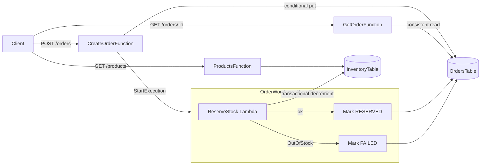

# mini-ofc — Serverless Order Fulfilment Backend

A small but production-minded order fulfilment backend on AWS. Clients place orders over an HTTP API; a Step Functions workflow reserves stock atomically and moves each order to `RESERVED` or `FAILED`.


## Architecture



## Highlights

- **Idempotent order creation.** `POST /orders` requires an `Idempotency-Key` header. The order ID is derived from the key, and the write is conditional (`attribute_not_exists`), so retries — even concurrent ones — create exactly one order. Reusing a key with a different body returns `409 Conflict`.
- **All-or-nothing stock reservation.** Stock for every SKU in an order is decremented in a single DynamoDB transaction guarded by `available >= qty`. Either the whole order is reserved or nothing changes — no overselling, no partial reservations.
- **Workflow orchestration with Step Functions.** Order processing runs as a Standard state machine. The execution is named after the order, so Step Functions itself rejects a duplicate workflow for the same order. Business failures (`OutOfStock`) are caught and recorded on the order, not lost in logs.
- **Direct service integrations.** The workflow updates order status with the native DynamoDB integration — no extra Lambda just to write a field.
- **Least-privilege IAM.** Each function gets only the SAM policy template it needs (read-only, write-only, or invoke).
- **Lean, fast functions.** TypeScript bundled and minified with esbuild, running on arm64 (Graviton), SDK clients reused across warm invocations.

## API

| Method | Path | Description | Responses |
| --- | --- | --- | --- |
| `GET` | `/products` | List products and available stock | `200` |
| `POST` | `/orders` | Place an order (needs `Idempotency-Key` header) | `202` created · `200` replay · `400` invalid · `409` key reused with different body |
| `GET` | `/orders/{id}` | Get an order and its status | `200` · `400` · `404` |

Order status moves `PLACED` → `RESERVED`, or `PLACED` → `FAILED` with a `failureReason`.

**Example**

```bash
curl -X POST "$API_URL/orders" \
  -H "Idempotency-Key: 7f9c2b1e-order-1" \
  -H "Content-Type: application/json" \
  -d '{"items":[{"sku":"SKU-1","qty":1}]}'
```

```json
{
  "orderId": "ord_65397a5f96c8faed",
  "status": "PLACED",
  "items": [{ "sku": "SKU-1", "qty": 1 }],
  "createdAt": "2026-10-14T05:29:04.868Z"
}
```

## Tech stack

TypeScript · Node.js 22 · AWS Lambda · Amazon API Gateway (HTTP API) · Amazon DynamoDB · AWS Step Functions · AWS SAM · esbuild · AWS SDK for JavaScript v3

## Getting started

**Prerequisites:** Node.js 22, [AWS SAM CLI](https://docs.aws.amazon.com/serverless-application-model/latest/developerguide/install-sam-cli.html), AWS credentials (`aws configure`), and esbuild on your PATH (`npm install -g esbuild`).

```bash
npm install
sam build
sam deploy --guided        # first time; afterwards just `sam deploy`
```

The deploy prints `HttpApiUrl` and `InventoryTableName`. Seed some stock:

```bash
npx tsx scripts/seed.ts <InventoryTableName>
```

Type-check the project:

```bash
npm run typecheck
```

To remove everything from your AWS account: `sam delete`.

## Project structure

```
├── src/
│   ├── handlers/
│   │   ├── createOrder.ts    # POST /orders — idempotent create + start workflow
│   │   ├── getOrder.ts       # GET /orders/{id}
│   │   ├── getProducts.ts    # GET /products
│   │   └── reserveStock.ts   # workflow step — transactional stock decrement
│   └── lib/orders.ts         # shared types and response helpers
├── statemachine/order.asl.json  # Step Functions workflow definition
├── scripts/seed.ts           # seeds the inventory table
├── docs/                     # design notes
└── template.yaml             # SAM infrastructure as code
```

## Roadmap

- Unit tests with mocked AWS clients, plus integration tests against a deployed stack
- CI pipeline (GitHub Actions) for type-checking, build, and deploy
- Authentication on the order endpoints
- Payment and shipping steps in the workflow, with compensation (release stock) on failure
- Structured logging, tracing, and alarms
