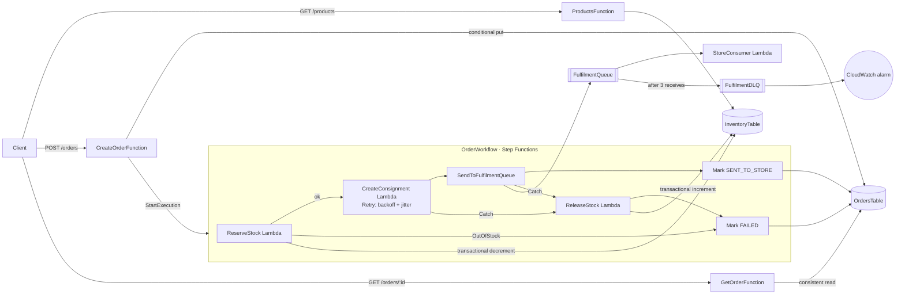

# mini-ofc — Serverless Order Fulfilment Backend

A small but production-minded order fulfilment backend on AWS. Clients place orders over an HTTP API; a Step Functions workflow reserves stock atomically, creates a consignment with retries, hands the order to the store over SQS and moves it to `SENT_TO_STORE`, or releases the stock and marks it `FAILED`.


## Skills demonstrated

| Area | What this project shows |
| --- | --- |
| **Distributed systems** | Idempotent APIs, saga pattern with compensating actions, at-least-once delivery, dead-letter queues, retry with exponential backoff + full jitter |
| **Data modelling & consistency** | DynamoDB conditional writes, multi-item `TransactWriteItems`, guard conditions to prevent overselling, idempotency markers inside the same transaction |
| **Workflow orchestration** | AWS Step Functions (ASL) with Retry/Catch, `ResultPath` error handling, native DynamoDB and SQS service integrations |
| **Infrastructure as code** | Entire stack in one AWS SAM template: parameters, queues, alarms, outputs, least-privilege IAM per function, linted with `cfn-lint` |
| **Reliability & operations** | Partial batch failure reporting, DLQ + CloudWatch alarm, DLQ redrive, fault injection via deploy parameters to exercise every failure path |
| **TypeScript engineering** | Strict typing across handlers, shared domain types, esbuild bundling, AWS SDK v3, plus a local demo panel that drives and visualises the live stack |

## Architecture



## Highlights

- **Idempotent order creation.** `POST /orders` requires an `Idempotency-Key` header. The order ID is derived from the key, and the write is conditional (`attribute_not_exists`), so retries — even concurrent ones — create exactly one order. Reusing a key with a different body returns `409 Conflict`.
- **All-or-nothing stock reservation.** Stock for every SKU in an order is decremented in a single DynamoDB transaction guarded by `available >= qty`. Either the whole order is reserved or nothing changes — no overselling, no partial reservations.
- **Workflow orchestration with Step Functions.** Order processing runs as a Standard state machine. The execution is named after the order, so Step Functions itself rejects a duplicate workflow for the same order. Business failures (`OutOfStock`) are caught and recorded on the order, not lost in logs.
- **Retries and compensation.** CreateConsignment retries transient errors with exponential backoff and full jitter. Anything that still fails after stock is reserved is caught, and a ReleaseStock step gives the stock back (a saga). The release is guarded by a marker on the order, so a retried release never adds stock twice.
- **Reliable hand-off to stores.** Orders go to an SQS queue with a dead-letter queue (3 attempts). The consumer reports partial batch failures, so one bad message does not redeliver the whole batch, and a CloudWatch alarm fires as soon as the DLQ has a message.
- **Direct service integrations.** The workflow updates order status with the native DynamoDB integration and sends to SQS with the native SQS integration — no extra Lambda just to write a field or a message.
- **Least-privilege IAM.** Each function gets only what it calls: a SAM policy template (read-only, write-only, invoke, send-message) or a single action such as `dynamodb:UpdateItem` on one table.
- **Lean, fast functions.** TypeScript bundled and minified with esbuild, running on arm64 (Graviton), SDK clients reused across warm invocations.

## API

| Method | Path | Description | Responses |
| --- | --- | --- | --- |
| `GET` | `/products` | List products and available stock | `200` |
| `POST` | `/orders` | Place an order (needs `Idempotency-Key` header) | `202` created · `200` replay · `400` invalid · `409` key reused with different body |
| `GET` | `/orders/{id}` | Get an order and its status | `200` · `400` · `404` |

Order status moves `PLACED` → `SENT_TO_STORE` (with a `consignmentId`), or `PLACED` → `FAILED` with a `failureReason` (`OutOfStock`, `ConsignmentServiceError`, …).

**Example**

```bash
curl -X POST "$API_URL/orders" \
  -H "Idempotency-Key: 7f9c2b1e-order-1" \
  -H "Content-Type: application/json" \
  -d '{"items":[{"sku":"SKU-1","qty":1}]}'
```

```json
{
  "orderId": "ord_65397a5f96c8faed",
  "status": "PLACED",
  "items": [{ "sku": "SKU-1", "qty": 1 }],
  "createdAt": "2026-10-14T05:29:04.868Z"
}
```

## Tech stack

TypeScript · Node.js 22 · AWS Lambda · Amazon API Gateway (HTTP API) · Amazon DynamoDB · AWS Step Functions · AWS SAM · esbuild · AWS SDK for JavaScript v3

## Getting started

**Prerequisites:** Node.js 22, [AWS SAM CLI](https://docs.aws.amazon.com/serverless-application-model/latest/developerguide/install-sam-cli.html), AWS credentials (`aws configure`), and esbuild on your PATH (`npm install -g esbuild`).

```bash
npm install
sam build
sam deploy --guided        # first time; afterwards just `sam deploy`
```

The deploy prints `HttpApiUrl` and `InventoryTableName`. Seed some stock:

```bash
npx tsx scripts/seed.ts <InventoryTableName>
```

Type-check the project:

```bash
npm run typecheck
```

To remove everything from your AWS account: `sam delete`.

## Demo panel

A local web page that runs every scenario against the deployed stack and shows the path each order took through the workflow (retries, backoff waits, compensation), plus the queue, DLQ, alarm and store-consumer logs.

```bash
npm run demo        # http://localhost:4000 — uses your AWS CLI credentials
```

Scenarios: happy path, retry then success, out of stock, all-or-nothing reservation, compensation, compensation run twice, store down → DLQ → alarm, redrive, idempotent replay, key conflict, invalid requests. The panel flips `FAIL_RATE` and `CONSUMER_FAIL` by editing the Lambda environment variables directly; the next `sam deploy` resets them to the `FailRate`/`ConsumerFail` parameters. Override the target with `STACK_NAME` and `AWS_REGION`.

## Project structure

```
├── src/
│   ├── handlers/
│   │   ├── createConsignment.ts # workflow step — simulated carrier, fails at FAIL_RATE
│   │   ├── createOrder.ts    # POST /orders — idempotent create + start workflow
│   │   ├── getOrder.ts       # GET /orders/{id}
│   │   ├── getProducts.ts    # GET /products
│   │   ├── releaseStock.ts   # compensation — transactional stock increment
│   │   ├── reserveStock.ts   # workflow step — transactional stock decrement
│   │   └── storeConsumer.ts  # SQS consumer with partial batch failures
│   └── lib/orders.ts         # shared types and response helpers
├── demo/                     # local demo panel (npm run demo)
├── statemachine/order.asl.json  # Step Functions workflow definition
├── scripts/seed.ts           # seeds the inventory table
├── docs/                     # design notes
└── template.yaml             # SAM infrastructure as code
```

## Design decisions and trade-offs

- **Saga instead of a distributed transaction.** Reserve → consign → hand off are separate steps with a compensating `ReleaseStock`. Between reservation and release the stock really is "taken", which is the intended meaning of *reserved*.
- **Retry only what is safe to repeat.** CreateConsignment derives its ID from the order ID, so a retry after a lost response returns the same consignment. ReleaseStock writes a `stockReleased` marker in the *same* transaction as the stock increment, so a retried compensation can never add stock twice.
- **Business errors are not retried.** `OutOfStock` is caught directly; retrying a business "no" only wastes time and money.
- **SQS Standard over FIFO.** Per-store ordering is not needed, so Standard gives higher throughput; the consumer is expected to dedupe on `orderId`/`consignmentId` because delivery is at-least-once.
- **Visibility timeout vs. function timeout.** The queue's visibility timeout is sized so a message is not redelivered while still being processed.
- **Fault injection as a first-class feature.** `FailRate` and `ConsumerFail` stack parameters let any failure path (retries, compensation, DLQ, alarm) be reproduced on demand rather than hoped for.

### Known limitations (and how I would fix them)

- `MarkCompleted` has no Retry, so a DynamoDB blip after the SQS send leaves the order `PLACED` although the store has it → add a Retry and alarm on `ExecutionsFailed`.
- A `sendMessage` that times out may still have been delivered, so the Catch could release stock for an order the store will pick → idempotent consumer that checks order status, or the transactional outbox pattern.
- If `ReleaseStock` exhausts its retries, stock leaks → alarm on failed executions plus a reconciliation job.
- SAM's SQS event attaches the managed `AWSLambdaSQSQueueExecutionRole` (scoped to `*`) → replace with a statement scoped to the queue ARN.
- The DLQ alarm has no action yet → `AlarmActions` to an SNS topic (email/PagerDuty).

## What I learned

- **Retry vs. Catch in Step Functions.** Retry repeats the *same* step for transient faults; Catch moves to a *different* path once retries are exhausted or the error is not retryable. Retry is evaluated first, and `ResultPath: "$.error"` keeps the original input so the compensation step still has `orderId` and `items`.
- **Why jitter matters.** With `IntervalSeconds 1, BackoffRate 2, MaxAttempts 3` the caps are 1s, 2s and 4s; `JitterStrategy: FULL` randomises each wait so hundreds of failing orders do not retry on the same second (thundering herd).
- **Idempotency is a design property, not a feature.** It shows up at every layer: the `Idempotency-Key` on the API, the execution name in Step Functions, deterministic consignment IDs, and the release marker in DynamoDB.
- **Reading DynamoDB transaction failures.** `TransactionCanceledException.CancellationReasons` tells you *which* item failed its condition, which is how ReleaseStock tells "already released" apart from a real error.
- **"Done" depends on whose job it is.** The workflow's job ends at "handed to the queue"; the store failing afterwards is surfaced by the DLQ and alarm, not by the order status. Knowing where each component's responsibility ends makes failures easier to reason about.
- **Least privilege takes deliberate effort.** Replacing broad SAM policy templates (`DynamoDBCrudPolicy`) with single actions on single tables showed how much access the defaults grant.
- **Proving failure paths.** Building the demo panel to force and visualise retries, compensation and DLQ redrive taught me more than the happy path did. A failure path you cannot reproduce on demand has not really been tested.

## Roadmap

- Unit tests with mocked AWS clients, plus integration tests against a deployed stack
- CI pipeline (GitHub Actions) for type-checking, build, and deploy
- Authentication on the order endpoints
- Payment step in the workflow
- Structured logging, tracing, and alarm notifications (SNS)
